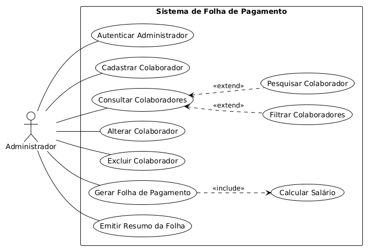
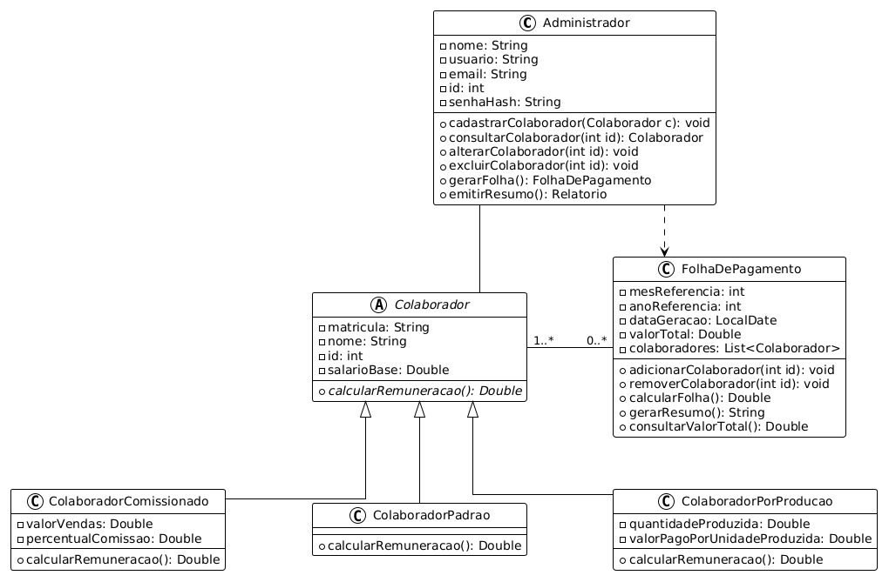
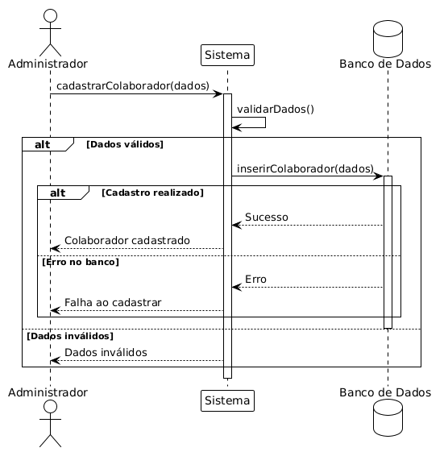
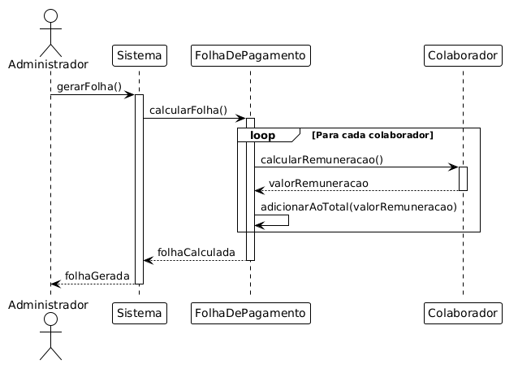
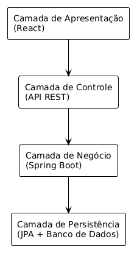

# Especificações de Requisitos de Software

> **Projeto:** Folha de Pagamento | **Data:** 05/10/2026

## 1. Introdução 

Este projeto tem como objetivo o desenvolvimento de um sistema de folha de pagamento que permita o cadastro, gerenciamento e cálculo de salários de colaboradores de diferentes categorias. Podendo gerar relatórios individuais e consolidados da folha de pagamento. A partir do desenvolvimento do sistema serão aplicadas práticas de gestão e qualidade buscando garantir o funcionamento correto e a qualidade do sistema. 

### 1.1 Escopo do projeto

O projeto contempla o desenvolvimento do sistema de folha de pagamento destinado ao gerenciamento de colaboradores e ao cálculo de suas respectivas remunerações, onde o sistema permitirá cadastrar, consultar, alterar e excluir colaboradores. Também podendo realizar de forma automática o cálculo salarial de acordo com a categoria de cada colaborador. 

Serão contempladas três categorias de remuneração no sistema: colaborador padrão, colaborador comissionado e colaborador por produção. Também irá permitir a geração da folha de pagamento individual e consolidada, apresentando os dados dos colaboradores, suas remunerações e o custo total da folha.

Além do desenvolvimento do sistema, o seguinte projeto abrangerá atividades relacionadas à garantia da qualidade de software, incluindo documentação, modelagem, testes, rastreabilidade de requisitos e validação da solução desenvolvida.

### 1.2 Partes Interessadas

| Stakeholder | Interesse |
|:------------|:----------|
| **Departamento Pessoal (DP)** | Usuário direto do sistema, responsável pelo cadastro, gerenciamento dos colaboradores e geração da folha de pagamento. | 
| **Gerente do Departamento Pessoal** | Usuário indireto interessado na eficiência operacional do setor e na confiabilidade dos cálculos salariais. | 
| **Colaboradores** | Indivíduos que terão suas informações inseridas e processadas no sistema. | 
| **Setor de Recursos Humanos (RH)**| Potencial beneficiário do sistema. Interesse na organização e precisão dos cálculos. |

### 1.3 Premissas 

- **P001:** A empresa disponibilizará as regras de remuneração necessárias para a implementação dos cálculos salariais.

- **P002:** Os usuários do sistema possuirão conhecimentos básicos de informática.

- **P003:** Os usuários do sistema terão acesso à internet.

- **P004:** Os usuários terão acesso a computadores com Windows 10 ou superior, ou distribuições Linux que disponham de navegadores web atualizados. 

### 1.4 Restrições 

- **R001:** O projeto deverá ser concluído até o dia 1º de dezembro de 2026 (01/12/2026).

- **R002:** O sistema não deverá depender de APIs externas para seu funcionamento.

- **R003:** Nesta versão, o sistema deverá contemplar exclusivamente as três categorias de remuneração definidas: padrão, comissionado e por produção. 

### 1.5 Benefícios Esperados 

É esperado que a implementação do sistema proporcione os seguintes benefícios aos usuários: 

- **Automatização dos cálculos salariais:** Redução da necessidade de cálculos manuais 

- **Redução de erros:** Diminuição de erros humanos no cálculo de remuneração dos colaboradores.

- **Centralização das informações:** Organização dos dados cadastrais e salariais dos colaboradores em um único sistema.

- **Eficiência operacional:** Redução do tempo necessário para o gerenciamento dos colaboradores e a geração das folhas de pagamento.

- **Facilidade de consulta:** Acesso simplificado às informações dos colaboradores e às folhas de pagamento individuais e coletivas.

- **Padronização dos processos:** Aplicação consistente das regras de remuneração definidas pela empresa.


## 2. Requisitos Funcionais (RF)

### 2.1 Cadastro e manutenção de colaboradores

| ID | Nome do Requisito | Descrição | Prioridade |
|:---|:------------------|:----------|:-----------|
| **RF001** | Cadastro de Colaborador | O sistema deverá permitir o cadastro de colaboradores contendo: matrícula, nome, salário base e tipo de colaborador. | Alta |
| **RF002** | Manutenção de Cadastros | O sistema deverá permitir alterar e excluir os dados cadastrais e remuneratórios dos colaboradores. | Alta |
| **RF003** | Confirmação de Exclusão | O sistema deverá solicitar confirmação antes da exclusão de um colaborador cadastrado. | Média |
| **RF004** | Cadastro de Colaborador Padrão | O sistema deverá permitir cadastrar colaboradores que recebem apenas salário base. | Alta |
| **RF005** | Cadastro de Colaborador Comissionado | O sistema deverá permitir informar: valor das vendas e percentual de comissão para o cálculo posterior da remuneração. Caso o percentual não seja informado, será o valor definido na (RN009) | Alta |
| **RF006** | Cadastro de Colaborador por Produção | O sistema deverá permitir informar: quantidade produzida e valor pago por unidade produzida para cálculo posterior da remuneração. | Alta |

### 2.2 Consulta e organização de colaboradores

| ID | Nome do Requisito | Descrição | Prioridade |
|:---|:------------------|:----------|:-----------|
| **RF007** | Consulta de Colaboradores | O sistema deverá apresentar a lista de colaboradores cadastrados contendo seus dados cadastrais e remuneratórios. | Média |
| **RF008** | Pesquisa de Colaboradores | O sistema deverá permitir pesquisar colaboradores por nome ou matrícula. | Média |
| **RF009** | Filtro por tipo de colaborador | O sistema deverá permitir filtrar os colaboradores cadastrados de acordo com sua categoria de remuneração. | Baixa |
| **RF010** | Ordenação de colaboradores | O sistema deverá permitir ordenar a lista de colaboradores por nome, matrícula ou salário final. | Baixa |

### 2.3 Cálculo e detalhamento da remuneração

| ID | Nome do Requisito | Descrição | Prioridade |
|:---|:------------------|:----------|:-----------|
| **RF011** | Cálculo de Salário | O sistema deverá apresentar automaticamente o salário final de cada colaborador de acordo com sua categoria de remuneração. | Alta |
| **RF012** | Detalhamento da Remuneração | O sistema deverá apresentar os valores utilizados no cálculo da remuneração final do colaborador. | Média |

### 2.4 Geração e emissão da folha de pagamento

| ID | Nome do Requisito | Descrição | Prioridade |
|:---|:------------------|:----------|:-----------|
| **RF013** | Geração de Folha de Pagamento | O sistema deverá gerar uma folha contendo: matrícula, nome, tipo de colaborador e valor do salário final. | Alta |
| **RF014** | Emissão individual e consolidada | O sistema deverá emitir uma folha individual contendo os dados e a remuneração de um colaborador selecionado, ou uma folha consolidada contendo todos os colaboradores e o valor total das remunerações | Média |
| **RF015** | Emissão de Resumo da Folha | O sistema deverá apresentar o valor total da folha de pagamento somando o salário final de todos os colaboradores. | Média |

### 2.5 Autenticação do administrador

| ID | Nome do Requisito | Descrição | Prioridade |
|:---|:------------------|:----------|:-----------|
| **RF016** | Autenticação do Administrador | O sistema deverá permitir que o administrador (usuários autorizados do DP)realize autenticação por meio de usuário e senha para acessar as funcionalidades do sistema. | Média |

## 3. Requisitos Não Funcinais  (RNF)

| ID | Nome do Requisito | Descrição | Prioridade |
|:---|:------------------|:----------|:-----------|
| **RNF001** | Usabilidade | O sistema deverá possuir uma interface amigável e intuitiva. | Média |
| **RNF002** | Validação de Dados | O sistema deverá validar os dados de entrada antes de efetuar qualquer cálculo ou salvar cadastros e alterações. | Alta |
| **RNF003** | Persistência de Dados | O sistema deverá armazenar os registros dos colaboradores de forma persistente. | Alta |
| **RNF004** | Extensibilidade | O sistema deverá permitir a futura inclusão de novos tipos de remuneração sem necessidade de alterar os cálculos já existentes. | Média |
| **RNF005** | Desempenho | O sistema deverá realizar operações de cadastro, consulta e cálculo sem atrasos perceptíveis durante o uso normal da aplicação. | Média |
| **RNF006** | Confiabilidade dos Cálculos | O sistema deverá produzir resultados consistentes para os cálculos de remuneração, considerando os dados cadastrados e as regras de negócio definidas. | Alta |
| **RNF007** | Integridade dos Dados | O sistema deverá preservar a consistência dos dados armazenados durante operações de cadastro, alteração e exclusão de colaboradores. | Alta |
| **RNF008** | Manutenibilidade | O sistema deverá possuir uma estrutura de código organizada e modular, facilitando sua manutenção e evolução. | Média |
| **RNF009** | Compatibilidade | O sistema deverá ser executável no ambiente definido para o projeto sem necessidade de configurações adicionais além das dependências documentadas. | Média |
| **RNF010** | Acesso ao Sistema | O acesso às funcionalidades administrativas deverá ser permitido somente após autenticação válida | Média |

## 4. Regras de Negócio (RN)

| ID | Nome da Regra | Descrição |
|:---|:--------------|:----------|
| **RN001** | Matrícula Única | Cada colaborador deverá possuir uma matrícula única dentro do sistema. |
| **RN002** | Nome Obrigatório | O nome do colaborador deverá ser informado obrigatoriamente no momento do cadastro. |
| **RN003** | Salário Base Válido | O salário base do colaborador não poderá possuir valor negativo. |
| **RN004** | Valor de Vendas Válido | O valor das vendas informado para colaboradores comissionados não poderá ser negativo. |
| **RN005** | Percentual de Comissão Válido | O percentual de comissão informado para colaboradores comissionados não poderá ser negativo e deverá estar entre 0% e 100%. |
| **RN006** | Quantidade Produzida Válida | A quantidade produzida informada para colaboradores por produção não poderá ser negativa. |
| **RN007** | Valor por Unidade Válido | O valor pago por unidade produzida não poderá ser negativo. |
| **RN008** | Cálculo Automático do Salário | O salário final deverá ser calculado automaticamente pelo sistema de acordo com a categoria do colaborador. |
| **RN009** | Comissão Padrão | Quando o administrador não informar o percentual de comissão no cadastro, o sistema deverá atribuir o percentual padrão de 5% |
| **RN010** | Remuneração Padrão | A remuneração será igual ao salário base |
| **RN011** | Remuneração Comissionada | A remuneração será igual ao salário base acrescido do valor das vendas multiplicado pelo percentual de comissão dividido por 100. Dada pela expressão: <br>$\text{SalárioBase} + (\text{ValorVenda} \times \frac{\text{Comissão}}{100})$ |
| **RN012** | Remuneração por Produção | A remuneração será igual ao salário base acrescido da quantidade produzida multiplicada pelo valor pago por unidade. Dada pela expressão: <br> $\text{Salário Base} + \text{Quantidade} \times \text{ValorUnidade}$ |

## 5. Casos de uso (UC)

| ID | Caso de uso | Requisitos relacionados |
|:---|:------------|:------------------------|
| **UC001** | Autenticar Administrador | RF016, RNF010 |
| **UC002** | Cadastrar Colaborador | RF001, RF004, RF005, RF006, RN001–RN007, RN009 |
| **UC003** | Consultar Colaboradores | RF007, RF012, RF010 |
| **UC004** | Alterar Colaborador | RF002, RN001–RN007, RNF002, RNF007 |
| **UC005** | Excluir Colaborador | RF002, RF003 |
| **UC006** | Pesquisar Colaborador | RF008 |
| **UC007** | Filtrar Colaboradores | RF009 |
| **UC008** | Calcular Salário | RF011, RN008, RN010-RN012 |
| **UC009** | Gerar Folha de Pagamento Geral e Individual| RF013, RF014 |
| **UC010** | Emitir resumo da Folha | RF015 |

## 6 Modelagem UML



### 6.1 Diagrama de Classes UML


> O diagrama de classes abstrai classes de implementação e outras partes da implementação.

### 6.2 Diagramas de Sequência UML

#### 6.2.1 Cadastrar Colaborador



#### 6.2.2 Gerar Folha de Pagamento



---

## 7 Arquitetura de Software

### 7.1 Arquitetura Adotada

O sistema de Folha de Pagamento será baseado em uma arquitetura em camadas, com separação entre frontend e backend monolítico. Esse modelo de arquitetura foi escolhido com o objetivo de organizar as responsabilidades do sistema, facilitando sua implementação, manutenção e realização de testes. A arquitetura será dividida em quatro camadas: 

- **Camada de Apresentação**: interface gráfica e interação com o usuário.

- **Camada de Controle**: responsável por expor os endpoints da API REST, receber as requisições HTTP da interface, validar o formato dos dados recebidos e encaminhar as operações à camada de negócio. Também será responsável por devolver as respostas HTTP ao frontend.

- **Camada de Negócio**: responsável pelas regras de negócio e pela coordenação das operações do sistema, incluindo o gerenciamento de colaboradores, o cálculo das remunerações e a geração das folhas de pagamento.

- **Camada de Persistência**: responsável pelo acesso, armazenamento e recuperação dos dados, utilizando repositórios com Spring Data JPA e o mapeamento entre os objetos Java e o banco de dados relacional.



### 7.2 Comunicação entre Camadas

A comunicação entre frontend e backend será feita com requisições HTTP, utilizando JSON para troca de dados. Enquanto as camadas internas usarão métodos Java sem novas requisições HTTP.

No backend, a camada de controle irá encaminhar as solicitações à camada de negócios, que irá executar as operações necessárias e utilizará a camada de persistência quando existir a necessidade de guardar ou consultar dados.

Essa separação de responsabilidades reduz o acoplamento, facilita a manutenção e evolução do sistema.

### 7.3 Tecnologias selecionadas

| Tecnologia | Finalidade |
|:-----------|:-----------|
| **React** | Desenvolvimento da interface web. |
| **Java** | Implementação do backend e regras de negócio. |
| **Spring Boot** | Estruturação e execução da aplicação backend. |
| **MySQL** | Armazenamento dos dados no sistema. |
| **Maven** | Gerenciamento de dependências no backend. |

### 7.4 Justificativas técnicas

A arquitetura e as tecnologias foram selecionadas considerando o escopo do projeto, o prazo de desenvolvimento e os requisitos de manutenção, persistência e confiabilidade dos cálculos.

- **Arquitetura em camadas com backend monolítico**: permite separar as responsabilidades, controle, negócio e persistência, facilitando a manutenção e testes. A organização do backend em uma única aplicação simplifica a execução e implantação, sendo adequada ao escopo do projeto.

- **React**: permite construir a interface utilizando componentes reutilizáveis, como formulários, tabelas e filtros. Essa abordagem facilita a padronização das telas e a atualização das informações apresentadas ao usuário.

- **Java**: a linguagem oferece tipagem estática e recursos de orientação a objetos permitindo representar as categorias de colaboradores e suas regras de remuneração de forma detalhada.

- **Spring Boot**: framework open-source baseado em Java que simplifica a configuração e execução do backend. Oferece, também, integração com os recursos necessários para a construção da API REST e o acesso ao banco de dados. Isso reduz o trabalho de configuração e facilita o desenvolvimento dentro do prazo do projeto.

- **MySQL**: permite armazenar os dados dos colaboradores. Oferece restrições de integridade, como impedir o cadastro de matrículas repetidas e suporte a transações, contribuindo para a consistência dos dados nas operações do sistema.

- **Maven**: centraliza o gerenciamento de dependências do projeto backend Java, facilitando a preparação do ambiente de desenvolvimento.

### 7.5 Organização do Projeto

O projeto será organizado na seguinte árvore de pastas, começando em `/folha-de-pagamento`, raiz do projeto que ramifica para as seções de documentação, frontend e backend. Sendo respectivamente `/doc`, `/frontend` e `/backend`.


```
folha-de-pagamento/
├─ doc/
│   └─ plantUML/
├─ frontend/
│   └─ ...
└─ backend/
    └─ ...
```

#### 7.5.1 Documentação

Na pasta `/doc` estão os arquivos de modelagem e engenharia que demonstram teoricamente o funcionamento do sistema. As subpastas incluem: `/plantUML`, onde se encontram os diagramas e arquivos contendo o código do plantUML. Também inclui `/prototipos`, que contém os protótipos de baixa fidelidade e os arquivos que guardam a formatação dos protótipos. 

```
doc/
├─ plantUML/
│   ├─ arq-diagram.plantUML
│   ├─ arq-diagram.png
│   ├─ class-diagram.plantUML
│   ├─ class-diagram.png
│   └─ ... 
└─ prototipos/
    └─ ...
```

#### 7.5.2 Frontend

Na pasta `/frontend` ficarão os arquivos necessários para o funcionamento do sistema React que rodará a interface do usuário. 

```
frontend/
 └── src/
      ├── components/
      ├── pages/
      ├── services/
      └── routes/
```
> **Aviso**: A estrutura do diretório poderá mudar conforme o desenvolvimento do projeto.

#### 7.5.3 Backend

```
backend/
    ├── pom.xml
    └── src/
         ├── main/
         │    ├── java/
         │    │    └── com/
         │    │         └── meurer/
         │    │              └── folhapagamento/
         │    │                   ├── controller/
         │    │                   ├── service/
         │    │                   ├── model/
         │    │                   ├── repository/
         │    │                   └── config/
         │    └── resources/
         └── test/
              └── java/
```
> **Aviso**: A estrutura do diretório poderá mudar conforme o desenvolvimento do projeto.

---

## 8 Plano de Garantia de Qualidade (PGQ)

O plano de garantia de qualidade (PGQ), estabelece práticas para prevenir, identificar e corrigir defeitos durante o desenvolvimento. Sendo seu objetivo garantir que o sistema atenda os requisitos documentados, preservar os dados dos colaboradores e executar corretamente os cálculos das três categorias de remuneração.

### 8.1 Padrões de codificação

O código deverá respeitar a arquitetura em camadas apresentada no projeto. No backend, os controladores receberão as requisições, os serviços executarão regras de negócio e os repositórios realizarão o acesso aos dados. No frontend, componentes, páginas de serviços de comunicação com a API deverão possuir responsabilidades definidas.

Será adotado os seguintes padrões:

- Utilização de nomes descritivos e consistentes para classes, métodos, variáveis e componentes.

- Em Java:
    - **Classes** em *PascalCase* e nomes contendo substantivos. Exemplo: `Administrador` e `ColaboradorPadrao`.
    - **Métodos e Atributos** em *camelCase* e nomes contendo verbos. Exemplo: `cadastrarColaborador()` e `removerColaborador()`.
    - **Constantes** em *UPER_SNAKE_CASE*. Exemplo: `SALARIO_MINIMO`.
- Em React: 
    - **Componentes** em *PascalCase* e **Variáveis** em *camelCase*.

- Identação com quatro espaços no Java e dois espaços no frontend.

- Métodos e componentes com responsabilidades delimitadas, evitando duplicação das regras de negócio.

- Evitar comentários. Código deve se explicar por si só.

- Validação das entradas no backend e mensagens claras na interface. A validação do frontend complementará a do servidor.

### 8.2 Controle de versões

O código, os testes e a documentação serão mantidas em um repositório no Github. A branch *main* representará a versão estável. Cada funcionalidade ou correção será desenvolvida em uma branch própria, por exemplo: `feature/cadastro-colaborador`.

Os commits deverão descrever a alteração realizada e, quando possível, indicar o requisito que está relacionado. As alterações serão integradas à branch principal por meio de solicitação de integração após a revisão e execução dos testes.

### 8.3 Processo de revisão técnica

Antes da integração, as alterações serão verificadas quanto a:
1. Atendimento aos requisitos e às regras de negócio relacionadas.
2. Correção dos cálculos e das validações.
3. Separação de responsabilidades e legibilidade do código.
4. Tratamento de erros, autenticação e integridade dos dados.
5. Adequação dos testes e atualização da documentação afetada.

O processo de revisão se dará pela utilização do checklist antes da integração. Os apontamentos deverão ser corrigidos ou justificados e registrados antes da aprovação.

### 8.4 Critérios de qualidade

| Critério | Forma de verificação |
|:---------|:---------------------|
| Correção funcional | Execução dos casos de teste vinculados aos RF001-RF016. |
| Confiabilidade dos cálculos | Comparação dos resultados com valores esperados calculados previamente conforme RN008-RN012. |
| Validação e integridade | Testes de entradas inválidas, matrícula duplicada e operações de persistência. |
| Controle de acesso | Verificação de login e de bloqueio das operações administrativas sem autenticação. |
| Usabilidade | Execução das tarefas principais, verificando clareza dos campos, mensagens e confirmações. |
| Manutenabilidade e extensibilidade | Revisão da modularização e do isolamento das regras de remuneração. |
| Compatibilidade | Execução nos ambientes definidos no plano de testes. |
| Desempenho | Medição das operações de cadastro, consulta e cálculo no cenário de referência |

### 8.5 Métricas adotadas

As seguintes metas são propostas para tornar a avaliação objetiva:

| Métrica | Cálculo ou registro | Meta proposta |
|:--------|:--------------------|:--------------|
| Cobertura dos requisitos funcionais por testes | RF com ao menos um caso associado / 16 * 100 | 100% |
| Execução dos testes planejados | Casos executados / casos planejados * 100 | 100% |
| Taxa de aprovação dos testes | Casos aprovados / casos executados * 100 | 100% |
| Tempo de resposta | Tempo entro envio da operação e recebimento da resposta completa | Até 2 segundos em pelo menos 29 de 30 medições de cada operação |

O cenário de desempenho deverá registrar hardware, sistema operacional, navegador e versões.

### 8.6 Critérios de aprovação

A versão será considerada aprovada quando:

- Todos os requisitos funcionais previstos estiverem implementados e vinculados aos testes.

- Todos os casos obrigatórios estiverem executados e aprovado.

- Os cálculos das três categorias e o total consolidado corresponderem aos resultados esperados.

- Não existirem defeitos críticos em aberto.

- Os critérios de qualidade e as metas acordadas estiverem atendidas.

## 8.7 Plano de Testes

### 8.7.1 Escopo

Os testes irão abranger a autenticação, cadastro, consulta, alteração, exclusão de colaboradores, pesquisa, filtros, ordenação, validação dos dados, cálculo, detalhamento da remuneração, emissão da folha individual, consolidada, totalização, persistência e integridade dos registros.

Também serão verificadas usabilidade, compatibilidade, organização do código, extensibilidade e desempenho conforme os critérios definidos no PGQ. 

### 8.7.2 Estratégia

Os testes serão realizados de forma incremental. As funções de cálculo e validação serão verificadas por testes unitários. A comunicação entre API, serviços e banco será avaliada por testes de integração. Os fluxos completos serão verificados na interface web.

Serão utilizados dados válidos, dados inválidos e valores limite, como salário zero, comissão de 0% e 100% e quantidades negativas. Após correções, os testes afetados e os principais fluxos de regressão serão executados novamente.

### 8.7.3 Níveis de teste

| Nível | Objetivo | Exemplos |
|:------|:---------|:---------|
| Unitário | Verificar regras isoladas. | Fórmulas salariais, comissão padrão e validações. |
| Integração | Verificar a colaboração entre componentes e banco. | Cadastro pela API, matrícula única e persistência das alterações. |
| Sistema | Verificar o comportamento completo da aplicação. | Login, cadastro pela interface e geração da folha. |
| Aceitação | Confirmar atendimento aos requisitos do projeto. | Execução dos fluxos principais pelo responsável pela validação. |

### 8.7.4 Ambiente

O ambiente conterá o frontend React, o backend Java com Spring Boot, Maven e uma instância MySQL exclusiva para testes. As versões utilizadas, os procedimentos de inicialização e a preparação dos dados deverão ser documentados.

Os testes de compatibilidade serão executados em Windows 10 ou superior e em uma distribuição Linux identificada no relatório, utilizando versões registradas de Chrome e Firefox. Os testes de integração de persistência usarão MySQL, evitando assumir que um banco substituto reproduz seu comportamento.

O conjunto de dados contemplará as três categorias, valores zero, limites de comissão e matrículas distintas. Não serão necessárias APIs externas para executar os fluxos de negócio.

### 8.7.5 Ferramentas

| Ferramenta proposta | Finalidade |
|:--------------------|:-----------|
| JUnit e recursos de teste do Spring Boot | Testes unitários e de integração do backend. |
| Mockito | Simulação de dependências em testes unitários, quando necessário. |
| Bruno | Verificação de requisições e respostas da API. |
| Chrome e Firefox, com ferramentas de desenvolvimento | Testes manuais, inspeção de falhas e medições. |

### 8.7.6 Critérios de entrada e saída

**Entrada:** requisitos e resultados esperados disponíveis, funcionalidade implementada, aplicação inicializando sem erros, banco preparado, dados e credenciais fictícios disponíveis. Os cenários dependentes de decisões pendentes só poderão ser aprovados após a definição da regra correspondente.

**Saída:** todos os casos previstos executados, resultados e evidências registrados, defeitos classificados, correções submetidas a reteste, regressão dos fluxos principais concluída, ausência de defeitos críticos.

### 8.7.7 Critérios de aprovação

Um caso será aprovado quando todos os resultados esperados forem observados. Será reprovado quando o resultado for diferente do esperado e bloqueado quando uma dependência impedir sua execução.

A aprovação global dependerá dos critérios do PGQ.

## 8.8 Especificação de Casos de Teste

Os casos abaixo estão planejados e ainda não possuem resultado de execução. Salvo indicação contrária, a aplicação e o banco deverão estar disponíveis e o administrador autenticado. Cada caso utilizará uma base restaurada ou registros exclusivos para evitar interferência entre execuções.

**Dados de referência:** colaborador padrão P001, salário base de R$ 2.000,00; comissionado C001, base de R$ 2.000,00, vendas de R$ 10.000,00 e comissão de 10%; por produção Q001, base de R$ 1.500,00, quantidade 100 e valor unitário de R$ 5,00. As remunerações esperadas são, respectivamente, R$ 2.000,00, R$ 3.000,00 e R$ 2.000,00; total de R$ 7.000,00.

### 8.8.1 Autenticação e cadastro

| ID | Objetivo e rastreabilidade | Pré-condição e dados | Procedimento | Resultado esperado |
|:---|:---------------------------|:---------------------|:-------------|:-------------------|
| CT001 | Login válido — RF016, RNF010 | Administrador cadastrado; sem sessão ativa. | Informar usuário e senha corretos e entrar. | Autenticação aceita e funcionalidades administrativas acessíveis. |
| CT002 | Login inválido — RF016, RNF010 | Sem sessão ativa. | Informar usuário válido e senha incorreta; tentar acessar funcionalidade protegida. | Login recusado e acesso administrativo bloqueado. |
| CT003 | Acesso direto sem autenticação — RNF010 | Sem sessão ativa. | Acessar uma rota administrativa e enviar diretamente uma requisição de cadastro à API. | Interface exige autenticação; API rejeita a operação; nenhum registro criado. |
| CT004 | Cadastro padrão — RF001, RF004, RN010 | Matrícula P001 inexistente. | Cadastrar P001, nome Ana, base 2.000 e categoria padrão; consultar. | Registro salvo com os dados informados e remuneração de R$ 2.000,00. |
| CT005 | Cadastro comissionado — RF005, RF011, RN011 | Matrícula C001 inexistente. | Cadastrar C001, nome Bruno, base 2.000, vendas 10.000 e comissão 10%. | Registro salvo e remuneração de R$ 3.000,00. |
| CT006 | Cadastro por produção — RF006, RF011, RN012 | Matrícula Q001 inexistente. | Cadastrar Q001, nome Carla, base 1.500, quantidade 100 e valor unitário 5. | Registro salvo e remuneração de R$ 2.000,00. |
| CT007 | Matrícula duplicada — RN001, RNF002, RNF007 | P001 já cadastrado. | Tentar cadastrar outra pessoa com matrícula P001. | Operação rejeitada; registro original preservado; mensagem informa duplicidade. |
| CT008 | Nome obrigatório — RN002, RNF002 | Matrícula nova e demais dados válidos. | Tentar salvar deixando o nome vazio. | Cadastro rejeitado e campo obrigatório indicado. |
| CT009 | Salário negativo — RN003, RNF002 | Matrícula nova e demais dados válidos. | Informar salário base de -0,01 e salvar. | Operação rejeitada e nenhum registro criado. |
| CT010 | Salário zero — RN003, RN010 | Matrícula nova; categoria padrão. | Cadastrar com salário base zero. | Cadastro aceito e remuneração de R$ 0,00. |
| CT011 | Vendas negativas — RN004 | Categoria comissionada e demais dados válidos. | Informar vendas de -0,01 e salvar. | Operação rejeitada e valor de vendas sinalizado. |
| CT012 | Comissão fora da faixa — RN005 | Categoria comissionada; demais dados válidos. | Tentar salvar com -0,01%; repetir com 100,01%. | As duas tentativas são rejeitadas e não persistem. |
| CT013 | Limites válidos da comissão — RN005, RN011 | Base 2.000 e vendas 10.000. | Cadastrar com 0%; repetir em registro distinto com 100%. | Ambas aceitas; remunerações de R$ 2.000,00 e R$ 12.000,00. |
| CT014 | Comissão padrão — RF005, RN009, RN011 | Base 2.000 e vendas 10.000. | Deixar o percentual sem preenchimento e salvar. | Sistema atribui 5% e calcula R$ 2.500,00. |
| CT015 | Quantidade negativa — RN006 | Categoria por produção e demais dados válidos. | Informar quantidade -1 e salvar. | Operação rejeitada e quantidade sinalizada. |
| CT016 | Valor unitário negativo — RN007 | Categoria por produção e demais dados válidos. | Informar valor unitário de -0,01 e salvar. | Operação rejeitada e valor sinalizado. |

### 8.8.2 Manutenção e consultas

| ID | Objetivo e rastreabilidade | Pré-condição e dados | Procedimento | Resultado esperado |
|:---|:---------------------------|:---------------------|:-------------|:-------------------|
| CT017 | Alteração e recálculo — RF002, RF011 | C001 com dados de referência. | Alterar vendas de 10.000 para 20.000; salvar e consultar novamente. | Dados persistidos e remuneração recalculada para R$ 4.000,00. |
| CT018 | Validação na alteração — RF002, RN003, RNF007 | P001 com base 2.000. | Tentar alterar a base para -1 e consultar novamente. | Alteração rejeitada; base anterior de R$ 2.000,00 preservada. |
| CT019 | Cancelamento da exclusão — RF003 | P001 cadastrado. | Solicitar exclusão e cancelar a confirmação. | Colaborador permanece cadastrado e aparece na consulta. |
| CT020 | Exclusão confirmada — RF002, RF003 | P001 cadastrado. | Solicitar exclusão, confirmar e consultar a lista. | Registro excluído e ausente da lista e da folha atual gerada posteriormente. |
| CT021 | Listagem — RF007 | Três colaboradores de referência cadastrados. | Abrir a consulta de colaboradores. | Os três aparecem com dados cadastrais e remuneratórios corretos. |
| CT022 | Pesquisa por nome e matrícula — RF008 | Dados de referência cadastrados. | Pesquisar o nome exato Ana; depois a matrícula C001. | Cada busca retorna o colaborador correspondente. |
| CT023 | Pesquisa sem resultados — RF008, RNF001 | Nenhum registro com matrícula X999. | Pesquisar X999. | Lista sem resultados e mensagem compreensível, sem erro de aplicação. |
| CT024 | Filtro por categoria — RF009 | Dados de referência cadastrados. | Selecionar cada uma das três categorias, uma por vez. | Em cada seleção aparecem apenas os colaboradores da categoria escolhida. |
| CT025 | Ordenação — RF010 | Dados de referência cadastrados. | Ordenar por nome, matrícula e salário final no sentido disponibilizado pela interface. | Nome e matrícula seguem a ordem correspondente; salário segue ordem numérica, mantendo empates sem exigir desempate não especificado. |
| CT026 | Detalhamento da remuneração — RF012 | C001 e Q001 com dados de referência. | Abrir o detalhamento de cada colaborador. | C001 mostra base 2.000, vendas 10.000, comissão 10%, adicional 1.000 e total 3.000; Q001 mostra base 1.500, quantidade 100, valor 5, adicional 500 e total 2.000. |

### 8.8.3 Folha, persistência e desempenho

| ID | Objetivo e rastreabilidade | Pré-condição e dados | Procedimento | Resultado esperado |
|:---|:---------------------------|:---------------------|:-------------|:-------------------|
| CT027 | Folha individual — RF013, RF014 | Dados de referência cadastrados. | Selecionar C001 e emitir sua folha. | Documento ou visualização apresenta apenas C001, com matrícula, nome, categoria e remuneração de R$ 3.000,00. |
| CT028 | Folha consolidada e resumo — RF013–RF015 | Somente os três registros de referência na base. | Emitir a folha consolidada e consultar o resumo. | Os três registros são apresentados uma vez cada; folha e resumo totalizam R$ 7.000,00. |
| CT029 | Persistência após reinicialização — RNF003, RNF007 | P001 cadastrado com base alterada para 2.500. | Reiniciar o backend sem limpar o banco; autenticar e consultar P001. | Dados permanecem disponíveis e remuneração é de R$ 2.500,00. |
| CT030 | Produção sem adicional — RN006, RN007, RN012 | Base 1.500; matrículas novas. | Cadastrar quantidade zero e valor 5; em outro registro, quantidade 100 e valor zero. | Ambos aceitos e com remuneração de R$ 1.500,00. |
| CT031 | Compatibilidade dos fluxos — RNF009 | Ambientes Windows, Linux e navegadores definidos no plano. | Em cada combinação, realizar login, cadastro, consulta e emissão da folha. | Fluxos concluídos, sem falhas que impeçam o uso; versões e evidências registradas por combinação. |
| CT032 | Tempo de resposta — RNF005 | Cenário de desempenho do PGQ preparado e ambiente registrado. | Medir 30 execuções de cadastro, 30 de consulta e 30 de cálculo. | Em cada operação, pelo menos 29 das 30 medições ficam em até 2 segundos. Nenhuma resposta incorreta. Meta sujeita à confirmação da equipe. |

Para cada execução, registrar: **ID do caso, versão/commit, ambiente, data, responsável, resultado obtido, situação (aprovado/reprovado/bloqueado), evidência e ocorrência associada**. Nos casos com múltiplas tentativas, registrar cada resultado; o caso só será aprovado se todas passarem. A cobertura de usabilidade, manutenibilidade e extensibilidade será complementada pelos checklists de revisão do PGQ.

## 8.9 Planejamento do Projeto

### 8.9.1 Estrutura Analítica do Projeto (EAP)

| Código | Entrega ou pacote de trabalho | Produto esperado |
|:-------|:------------------------------|:-----------------|
| 1 | Gestão e planejamento | Plano de execução e acompanhamento. |
| 1.1 | Definição do escopo e das atividades | Escopo revisado e lista de atividades. |
| 1.2 | Cronograma e responsabilidades | Datas, dependências e papéis definidos. |
| 1.3 | Acompanhamento | Registro de progresso, riscos e impedimentos. |
| 2 | Requisitos e projeto da solução | Documentação técnica revisada. |
| 2.1 | Requisitos e regras de negócio | Especificação validada e decisões pendentes resolvidas. |
| 2.2 | Modelagem UML e arquitetura | Diagramas coerentes com a solução. |
| 2.3 | Protótipos da interface | Telas de referência para os fluxos principais. |
| 3 | Implementação do backend | API e regras de negócio implementadas. |
| 3.1 | Configuração e persistência | Aplicação inicial, entidades e banco. |
| 3.2 | Autenticação e controle de acesso | Operações administrativas protegidas. |
| 3.3 | Gestão dos colaboradores | Cadastro, consulta, alteração, exclusão e validações. |
| 3.4 | Cálculos e folha | Remuneração, detalhamento e folhas individual e consolidada. |
| 4 | Implementação do frontend | Interface web integrada. |
| 4.1 | Autenticação e navegação | Tela de login e acesso aos fluxos. |
| 4.2 | Cadastros e consultas | Formulários, listagem, pesquisa, filtros e ordenação. |
| 4.3 | Remuneração e folha | Apresentação dos cálculos, folhas e resumo. |
| 5 | Qualidade e testes | Evidências de conformidade. |
| 5.1 | PGQ e especificação dos testes | Planos, casos e rastreabilidade. |
| 5.2 | Testes durante a implementação | Testes unitários e de integração. |
| 5.3 | Validação do sistema | Testes de sistema, compatibilidade, desempenho e aceitação. |
| 5.4 | Correções e regressão | Ocorrências tratadas e resultados atualizados. |
| 6 | Entrega | Versão final e documentação. |
| 6.1 | Revisão documental | Instruções de execução, relatórios e documentação consolidada. |
| 6.2 | Homologação e apresentação | Aceite registrado e demonstração preparada. |

### 8.9.2 Cronograma proposto

O cronograma abaixo considera a continuação do trabalho a partir de 19/10/2026 e a conclusão até 01/12/2026. Não pressupõe que as atividades anteriores já tenham sido concluídas. O documento recebido será utilizado como base para revisão. As datas devem ser ajustadas à disponibilidade da equipe sempre preservando o prazo final.

| Atividade | Período proposto | Dependência principal | Marco ou entrega |
|:----------|:-----------------|:----------------------|:-----------------|
| Revisar requisitos, esclarecer decisões e definir responsabilidades | 19/10 a 23/10 | Documento atual | Escopo e critérios acordados. |
| Revisar UML, arquitetura e protótipos | 19/10 a 26/10 | Requisitos disponíveis | Projeto da solução revisado. |
| Preparar ambiente, repositório e banco de testes | 19/10 a 23/10 | Tecnologias definidas | Aplicação inicial executável. |
| Implementar persistência, autenticação e manutenção de colaboradores | 24/10 a 06/11 | Ambiente e regras revisadas | API dos fluxos principais. |
| Implementar cálculos e emissão da folha | 02/11 a 10/11 | Modelo de colaboradores | Regras salariais e folhas funcionais. |
| Implementar e integrar interface | 26/10 a 13/11 | Protótipos e contratos da API | Fluxos completos na interface. |
| Consolidar PGQ, casos e rastreabilidade | 19/10 a 30/10 | Requisitos revisados | Base de testes definida. |
| Desenvolver e executar testes unitários e de integração | 24/10 a 17/11 | Incrementos implementados | Evidências e defeitos registrados. |
| Executar testes de sistema, compatibilidade e desempenho | 14/11 a 20/11 | Interface integrada | Relatório de validação. |
| Corrigir defeitos e executar regressão | 21/11 a 25/11 | Resultados dos testes | Versão candidata validada. |
| Revisar documentação e realizar aceite | 26/11 a 27/11 | Versão candidata | Entrega preparada e aceite registrado. |
| Reserva para ajustes finais | 28/11 a 30/11 | Pendências finais | Pacote final conferido. |
| Entregar e apresentar | 01/12 | Critérios de aprovação atendidos | Entrega final. |

As atividades sobrepostas pressupõem trabalho em paralelo ou alternância entre tarefas. Caso a equipe tenha apenas um integrante ou disponibilidade reduzida, deverá reavaliar o esforço e as sobreposições. O cronograma representa uma proposta de datas, não uma estimativa de horas já validada.

O acompanhamento será semanal, comparando entregas previstas e concluídas. Atrasos ou mudanças de escopo deverão ser registrados, avaliando o impacto sobre as dependências e o prazo final.


